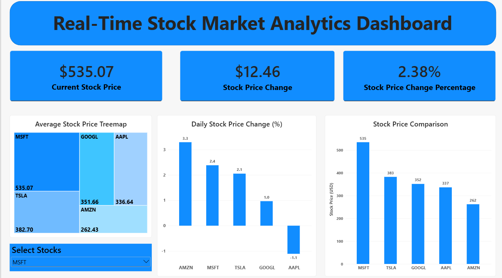
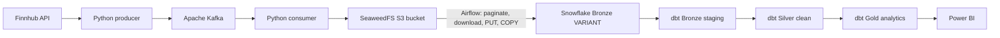
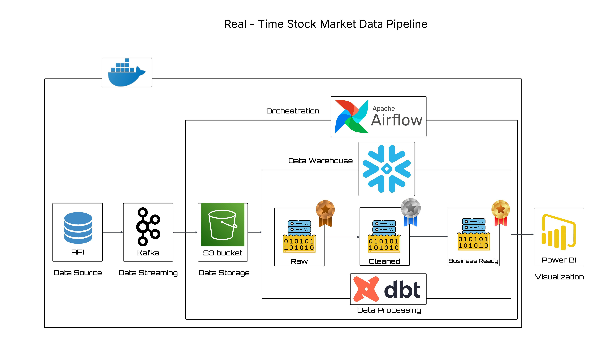

# Real-Time Stock Market Data Engineering Pipeline

**From Finnhub API and Kafka streaming to Snowflake analytics, dbt SQL models and a Power BI dashboard.**

A hands-on data engineering portfolio project that collects quotes for five US-listed stocks, stores JSON snapshots in an S3-compatible data lake, orchestrates warehouse ingestion with Airflow and models data for interactive business intelligence.



## Project results

| Metric | Verified result |
|---|---|
| Stocks covered | AAPL, AMZN, GOOGL, MSFT, TSLA |
| Snowflake raw Bronze records | **6,608** (October 11, 2026 snapshot) |
| Airflow S3 extraction | **3,608 objects across 4 listing pages** in the confirmed pagination run |
| dbt build | **7/7 models succeeded** in the original workspace (5 custom + 2 starter models) |
| Dashboard | 3 stock KPI cards, price comparison, price-change comparison, average-price treemap, symbol slicer |
| Historical market days available | 1 (`2026-10-09`); no multi-day candlestick visualization claimed |

> **Data freshness:** The project is a near-real-time ingestion proof of concept, not a live trading terminal. Quote polling can run continuously, but Airflow ingestion is manually triggered, dbt models run on demand and Power BI must be refreshed. Screenshots reflect the recorded dataset, not today's market prices.

## Architecture



This project uses SeaweedFS as S3-compatible storage because of container-image availability during development. The Docker Compose service keeps the historical name `minio`, but the running storage engine is **SeaweedFS**, not MinIO.



*The supplied reference illustration labels the storage step generically as an S3 bucket; the actual local implementation uses SeaweedFS.*

## Technology stack

| Layer | Technology | Role |
|---|---|---|
| Market data | Finnhub REST API | Quotes for five stock symbols |
| Streaming | Apache Kafka, ZooKeeper, Kafka Python client | Message ingestion and consumption |
| Object storage | SeaweedFS S3, Boto3 | JSON Bronze objects grouped by symbol |
| Orchestration | Apache Airflow 2.9.3, PostgreSQL | Manual S3-to-Snowflake DAG, task metadata |
| Cloud warehouse | Snowflake, Python Snowflake connector | JSON VARIANT ingestion and SQL views |
| SQL transformations | dbt Core 1.12.5, dbt-snowflake 1.12.1 | Bronze, Silver, Gold models |
| Visualization | Microsoft Power BI, DAX | Stock KPI cards, chart comparisons and treemap |
| Local environment | Docker Compose, Python | Reproducible demonstration stack |

## Bronze → Silver → Gold

**Raw Bronze:** `STOCKS_DBM.COMMON.BRONZE_STOCK_QUOTES_RAW` stores each JSON record in `V VARIANT`.

**Bronze staging (`bronze_stg_stock_quotes`):** extracts Finnhub fields (`c`, `d`, `dp`, `h`, `l`, `o`, `pc`, `t`), symbol and ingestion timestamp.

**Silver (`silver_clean_stock_quotes`):** filters invalid current-price rows and rounds selected quote fields.

**Gold:**

- `gold_kpi`: latest fetched quote per symbol for cards and price-change comparisons.
- `gold_treechart`: average observed price on the latest market date plus price-dispersion metrics.
- `gold_candlestick`: one-day aggregated sample-based OHLC-like data, retained as an extension model; not used as multi-day candles in the dashboard.

The checked-in repository contains **five custom dbt models**. A previous local `dbt run` log included **two dbt starter models** that were not supplied in this ZIP; the logged `PASS=7` is accurately attributed to that earlier environment, not claimed as a new run of this cleaned archive. Included schema tests need to be executed with `dbt test`.

## Dashboard highlights

The interactive report compares the five latest stock prices, daily change percentages and average observed prices. Selecting a symbol changes the three KPI cards while cross-comparison charts remain visible for all five. The dashboard is a periodically refreshed snapshot rather than a live-updating quote stream.

- **Current Stock Price**, **Change Amount**, **Change Percentage** for one selected stock.
- **Stock Price Comparison**: per-symbol latest quote.
- **Daily Stock Price Change (%)**: comparison of gains and losses across stocks.
- **Average Stock Price Treemap**: relative latest-day average quote price; **not** market capitalization.

The editable Power BI file is at [`powerbi/Stock_Market_Analytics.pbix`](powerbi/Stock_Market_Analytics.pbix). When opened outside the original environment, connect it to your own Snowflake account before refreshing.

## Project structure

```text
.
├── README.md
├── .env.example
├── .gitignore
├── requirements.txt
├── infra/
│   ├── docker-compose.yml
│   ├── Dockerfile.airflow
│   ├── requirements-airflow.txt
│   ├── dags/minio_to_snowflake.py
│   ├── producer/producer.py
│   └── consumer/consumer.py
├── stock_dbt/
│   ├── dbt_project.yml
│   ├── profiles.yml.example
│   └── models/
│       ├── bronze/
│       ├── silver/
│       ├── gold/
│       └── schema.yml
├── powerbi/
│   ├── Stock_Market_Analytics.pbix
│   └── dashboard.png
└── docs/
    ├── architecture.md
    ├── setup.md
    ├── validation.md
    ├── troubleshooting.md
    ├── cv_bullets.md
    └── images/pipeline-diagram.jpeg
```

## Quick start

1. Copy `.env.example` to `.env`, insert **new** API/database credentials, and copy `.env` to `infra/.env` for Compose. Never commit either file.
2. Install Python packages from `requirements.txt` in a Python 3.10+ virtual environment; load environment variables into both terminals.
3. Run the Docker stack from `infra/`, initialize Airflow, and start the Python consumer and producer. Confirm all five symbols reach `s3://bronze-transactions/`.
4. Create `STOCKS_DBM.COMMON.BRONZE_STOCK_QUOTES_RAW (V VARIANT)` in Snowflake, then manually trigger `minio_to_snowflake` in the Airflow UI (`localhost:8080`).
5. Configure your local `stock_dbt` profile with `profiles.yml.example`, run `dbt debug`, `dbt run`, then `dbt test`.
6. Open the `.pbix` report and connect/refresh the Snowflake Gold views.

For precise Windows commands and service initialization instructions, read **[Full setup](docs/setup.md)**.

## Major challenge and resolution

**Challenge:** Only AAPL and AMZN appeared in Snowflake/Power BI, even though Kafka and S3 contained all five symbols.

**Root cause:** the Airflow download function used a single `list_objects_v2` call, which returns at most one page (up to 1,000 objects). Object-key ordering concentrated early results in the first stock prefixes.

**Resolution:** implemented S3 pagination with Boto3. The verified Airflow run downloaded **3,608 files across four pages**, found all five symbols, and the Snowflake Bronze table ultimately held **6,608 records**.

Additional lessons and constraints are documented in [Troubleshooting](docs/troubleshooting.md) and [Architecture](docs/architecture.md).

## Validation and known limitations

- SQL checks for the Bronze distribution and Gold outputs: [Validation](docs/validation.md).
- The previously observed `dbt run` completed successfully; the newly added tests have not yet been executed.
- The archived candlestick model has only one trading date and derives open/close from sampled current prices, so it is not presented as a multi-day trading chart.
- Polling static weekend quotes can create repeated observations and zero within-sample volatility.
- The current Airflow design is educational: thousands of small objects and one PUT per object are inefficient compared with batched ingestion.

## Security and publishing notes

The originally shared code contained hardcoded credentials. This sanitized public template uses environment variables and a placeholder-only `.env.example`. **Revoke/rotate previously exposed Finnhub and Snowflake credentials**, and independently review any older commits or external copies before publishing. Store only your own `.env` locally. Examine the Power BI file's data source settings to confirm you're comfortable publishing its connection metadata.

## Portfolio summary

Built a multi-component streaming and analytics prototype connecting Finnhub API, Kafka, SeaweedFS S3, Apache Airflow, Snowflake, dbt and Power BI. Demonstrated JSON ingestion, SQL modeling, task orchestration, interactive analytics and debugging of a pagination defect that had hidden three of five stock symbols.

[CV-ready project bullets](docs/cv_bullets.md)
