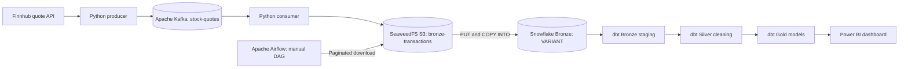

# Architecture and data model

## End-to-end flow

Docker Compose runs ZooKeeper, Kafka, Kafdrop, SeaweedFS (retaining the `minio` hostname from the local prototype), PostgreSQL and Airflow. The Finnhub producer, Kafka consumer and dbt CLI run on the host. Snowflake is a managed cloud warehouse; Power BI Desktop connects to Snowflake. The streaming ingestion is not continuous end-to-end: Airflow is manually triggered, dbt is manually run, and Power BI refresh is separate.

## Data contracts and transformations

| Layer | Object | Purpose |
|---|---|---|
| Kafka | `stock-quotes` | JSON Finnhub quotes with `symbol` and `fetched_at` |
| Object storage | `s3://bronze-transactions/SYMBOL/...json` | One message per JSON object |
| Snowflake raw | `STOCKS_DBM.COMMON.BRONZE_STOCK_QUOTES_RAW` | A single `V VARIANT` column with raw JSON |
| dbt bronze | `bronze_stg_stock_quotes` | Extracts numeric quote fields and timestamps |
| dbt silver | `silver_clean_stock_quotes` | Filters null prices and rounds derived fields |
| dbt gold | `gold_kpi` | Most recent fetched quote per stock |
| dbt gold | `gold_treechart` | Mean price on latest observed market date, plus dispersion |
| dbt gold | `gold_candlestick` | Aggregated sampled open/close/high/low by symbol/day; not an exchange-certified OHLC history |

Finnhub fields in the source JSON include: `c` current price, `d` change amount, `dp` change percentage points, `h` intraday high, `l` intraday low, `o` session open, `pc` prior close and `t` market Unix timestamp in seconds. Ingestion adds `symbol` and `fetched_at` (Unix seconds).

### Gold KPI selection

The KPI view applies `ROW_NUMBER() OVER (PARTITION BY symbol ORDER BY fetched_at DESC) = 1`, returning one last-ingested quote per symbol. It is a snapshot, not a streaming Power BI DirectQuery dashboard.

### Candlestick limitation

The included `gold_candlestick` model is retained for future use, but the Oct 2026 dataset covered only one trading date (2026-10-09). Moreover, its open/close fields are derived from the first and last sampled current prices, so this view should not be presented as true multi-day market OHLC candles without historical quotes and validation.

### Key engineering choice: S3 pagination

S3 `list_objects_v2` retrieves only one page by default. The original Airflow loader stopped after the first page, making only AAPL and AMZN appear downstream. A Boto3 paginator reads all pages; the verified run downloaded 3,608 objects across four pages and detected all five stock symbols.

## Operating scope and limitations

- API polling fetches snapshots, not individual trade ticks; repeated polling outside market hours may yield identical prices.
- The proof-of-concept writes many small JSON files. A production version should batch files, use managed stages or external stages, and avoid a large file-path list in XCom.
- `COPY INTO` normally tracks prior loaded files by filename; this workflow still re-uploads all S3 objects to the Snowflake table stage and is not a production-grade exactly-once pipeline.
- S3 credentials and local service isolation should be verified for SeaweedFS deployments; the local sample must not be exposed to the internet.
- The displayed 6,608 records describe the validated October 11, 2026 run, not a continuously updating figure.
